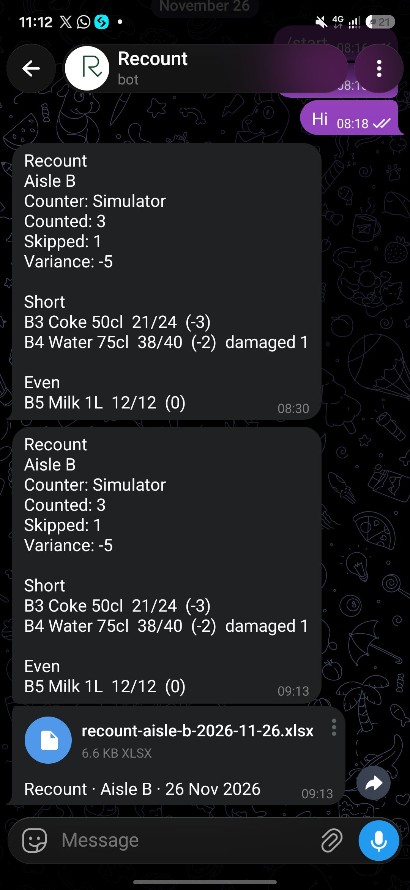
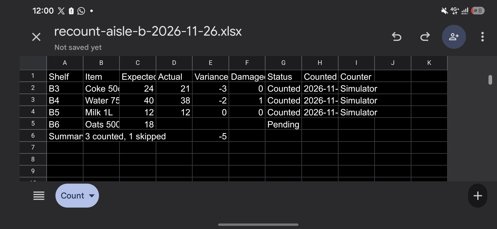
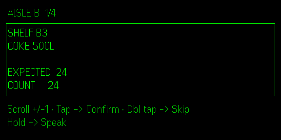
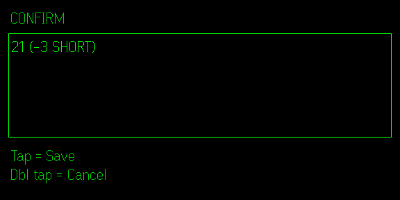
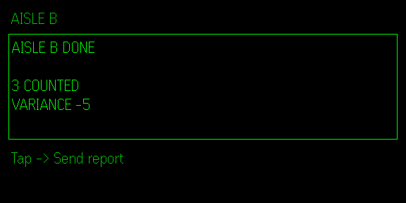
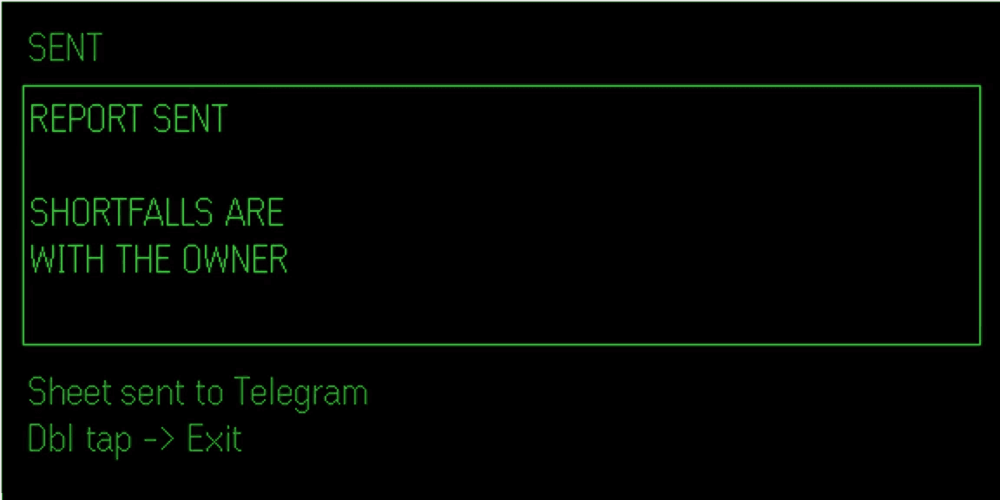

# Recount

[](https://github.com/ahmardchain/recount/actions/workflows/ci.yml)

Count a shelf without putting the box down.

A worker in a small shop, pharmacy, café, or stockroom still counts with a clipboard. Both hands are on the boxes, the count is slow, and a shortage sits there until the owner notices it late.

The cost of those gaps is well documented:

- In *Retail Out-of-Stocks: A Worldwide Examination of Extent, Causes and Consumer Responses* ([Gruen, Corsten and Bharadwaj, 2002](https://www.supplychain247.com/images/pdfs/GMA_2002_Worldwide_OOS_Study.pdf)), the average out-of-stock rate across 40 studies worldwide was 8.3 percent, and “a typical retailer loses about 4 percent of sales due to having items out-of-stock.”
- DeHoratius and Raman (2008), in *Management Science*, examined nearly 370,000 inventory records from 37 stores of one retailer and found 65% to be inaccurate: the recorded quantity did not match the quantity found in the store. ([doi:10.1287/mnsc.1070.0789](https://doi.org/10.1287/mnsc.1070.0789))
- IHL Group’s 2026 Inventory Distortion Study (July 2026) put the combined cost of out-of-stocks and overstocks at $1.7 trillion globally, equal to 6.2% of global retail sales. Empty shelves accounted for $690.9 billion. ([IHL research findings](https://www.ihlservices.com/news/ihl-research-findings/))

Recount is ring-first and hands-free. The count stays on the Even Realities G2 lens, a tap writes it back to Notion, and one more tap at the end of the aisle sends the owner a Telegram report. The Even R1 ring changes the count. That path does not need a microphone. Shortages are listed first, then the same aisle goes out as a spreadsheet.

Submitted on 26 Nov 2026 to the DoraHacks “Heads Up: Even Realities Hackathon”, Track 04 (AI Assistants & Work) and Best Telegram.

Watch the [demo video](https://youtu.be/Hj2fdArDaIg), or jump to [For judges](#for-judges) for every live link.

The glasses page is an Even Hub app. It uses `@evenrealities/even_hub_sdk` **0.0.16** (Even App 2.2.10 or newer) and is exercised in `@evenrealities/evenhub-simulator` **0.9.5**. The phone WebView never talks to Notion, Telegram, or a model vendor. A small Node server holds those tokens.


Aisle card from the Even Hub simulator 0.9.5, at the G2 display size of 576×288 monochrome. Captured during the official demo flow. This is the simulator, not a headset run.

## For judges

About 4 minutes in total:

1. **(30 s)** Open the [site](https://recount-beryl.vercel.app). This is the marketing page, with live Telegram phone photos further down.
2. **(1 min)** Click **Try the live demo**, or open the [glasses page](https://recount-beryl.vercel.app/glasses/?demo=1) directly. That is the Even Hub app and the shop view beside it, talking to the mock API on the same origin. It is a browser page, not a G2 headset run. Ring gestures need the Even Hub simulator, which you can start locally (see [Run locally](#run-locally)).
3. **(10 s)** Open [https://recount-beryl.vercel.app/api/health](https://recount-beryl.vercel.app/api/health). It should return `ok: true` and `mode: "mock"` (sample shop data, no Notion or Telegram keys on this host).
4. **(1 min 37 s)** Watch the [demo video](https://youtu.be/Hj2fdArDaIg) (official Even Hub simulator, with captions).
5. **(1 min)** Look at the [proof table](#proof) and the official [criteria](#official-criteria) below.

### Live links

| | |
| --- | --- |
| Site | https://recount-beryl.vercel.app |
| Glasses page | https://recount-beryl.vercel.app/glasses/?demo=1 |
| Mock API health | https://recount-beryl.vercel.app/api/health |
| Demo video | https://youtu.be/Hj2fdArDaIg |
| CI | https://github.com/ahmardchain/recount/actions/workflows/ci.yml |
| Repository | https://github.com/ahmardchain/recount |

### Proof

| Claim | Evidence |
| --- | --- |
| The public API is up, in mock mode, with the regex parser | [GET /api/health](https://recount-beryl.vercel.app/api/health) returns `{"ok":true,"mode":"mock","notion":"mock","telegram":"mock","parser":"regex","stt":"none"}` |
| Sample aisle data is the built-in catalog | [GET /api/inventory?location=Aisle%20B](https://recount-beryl.vercel.app/api/inventory?location=Aisle%20B) returns four items; the first is `b3`, Coke 50cl |
| A mock aisle report is an `.xlsx` workbook | `POST /api/report` with `{"location":"Aisle B","counter":"Counter"}` returns `sheetFile` ending in `.xlsx` |
| The owner’s phone received a Telegram alert and the aisle spreadsheet | Photos from the live run on 26 Nov 2026: [telegram-phone.jpg](docs/screens/telegram-phone.jpg), [spreadsheet-phone.jpg](docs/screens/spreadsheet-phone.jpg) |
| The lens layout is 576×288 monochrome in the official simulator | [02-item.png](docs/screens/02-item.png), captured during the official demo flow. This is the simulator, not a headset run |
| Typecheck, build, and tests run in CI | [CI badge](https://github.com/ahmardchain/recount/actions/workflows/ci.yml); `npm test` lists 22 tests in `package.json` |

### Official criteria

| Criterion | Weight | What to look at |
| --- | --- | --- |
| Usefulness on G2 | 30% | Both hands stay on the stock. One item and one number on the lens; the R1 ring changes the count. That path does not need a microphone. |
| Read and write | 25% | The aisle is read from Notion (or the built-in mock shop). A confirmed count is written back. The owner gets a Telegram `sendMessage`, shortages first, then the aisle `.xlsx` with `sendDocument`. |
| Technical execution | 20% | SDK 0.0.16 page containers, a 300 ms ring debounce, a two-step confirm, a 3 s undo, and a parser with a deterministic fallback. A packable `.ehpk` (`npm run pack`), a live HTTPS API on the same Vercel origin as the site, 22 tests and GitHub Actions CI. Mock mode needs no keys. |
| UX for display and voice | 15% | 576×288 monochrome. Scroll, tap, double-tap, and an optional short phrase. The confirm card is a second look, not a form. Live voice in the simulator uses your computer’s microphone, or a typed transcript or WAV. |
| Business potential and safety | 10% | The buyer is the shop owner who finds shortages late. No payments and no customer accounts. Tokens stay on the server. See [Safety and data](#safety-and-data). |

## Why glasses, not a phone

A phone already has a counting app. The problem is the moment the counting happens.

- **Hands stay on the stock.** A phone needs a free hand to hold and type. On the glasses, the expected number sits in view and the ring changes the count, so both hands keep moving boxes.
- **Eyes stay on the shelf.** Looking down at a screen between every item breaks the count and is where mistakes slip in. The lens shows one item and one number at a time, right next to the shelf.
- **Nothing to put down or pick up.** No unlocking, no wiping dusty fingers on a screen, and no phone balanced on a box in a cold room or a busy back room.
- **The phone still has a job.** It's where the owner gets the Telegram alert and the spreadsheet. The worker counts on the glasses, and the owner reads the result on the phone.

## Live Telegram report

From the live run on 26 Nov 2026: the owner’s phone received the Aisle B alert, then the aisle `.xlsx`.



The Recount bot in Telegram: the Aisle B alert and the aisle spreadsheet.



The aisle spreadsheet opened on the owner's phone.

## Screenshots

Live frames from the official Even Hub simulator.

| Aisle card | Confirm |
| --- | --- |
|  |  |
| One shelf at a time, expected vs count. | A second tap writes 21 (−3) to Notion. |

| Summary | Sheet sent |
| --- | --- |
|  |  |
| Three counted, oats skipped, variance −5. | The glasses confirm the spreadsheet went out. |

## How it works

The core path is a lens count, a Notion write-back, then a Telegram report. Voice is optional.

1. The glasses load one location from the Shop Inventory database. In mock mode that database is built in. With a Notion token, the same screen reads the live database.
2. One card shows the shelf, the item, the expected quantity, and the count. Scroll the R1 ring to add or subtract one. Tap to open a confirm card. Tap again to write the count, the variance (counted minus expected), the time, and the counter’s name. Tapping again within 3 seconds undoes it. Double-tap skips the item. Hold the ring, or choose Speak, and a phrase such as “twelve” or “two boxes of six” becomes the number on that confirm card.
3. The last card shows how many items were counted and the total variance. One tap sends the owner a Telegram `sendMessage`, then the aisle workbook with `sendDocument`. Shortages are listed before overs and exact matches. The glasses card then reads “Sheet sent to Telegram”.

The ring path does not need a microphone. Voice is an extra: hold the ring, or press Listen live on the shop page, and speak a count such as “thirty-eight, one damaged.” Live speech uses your computer’s microphone in Chrome or Edge, not the G2 headset. The simulator glasses microphone is not used. You can still type a transcript or attach a WAV; the same parser runs either way. The count is not written until you tap to confirm.

## Run locally

Node 22 or newer. The public glasses page and mock API are linked under [For judges](#for-judges). The commands below start the same app on your machine, which is what `npm run sim` and `npm run demo` need.

```bash
npm install
npm test
npm run dev
```

In a second terminal, with the [WebKitGTK 4.1](https://hub.evenrealities.com/docs/test/simulator) libraries installed:

```bash
npm run sim
```

In a third terminal, once the glasses show the first item:

```bash
npm run demo
```

- Glasses and this page: [http://127.0.0.1:4179/?demo=1](http://127.0.0.1:4179/?demo=1)
- API: [http://127.0.0.1:4187/api/health](http://127.0.0.1:4187/api/health)
- Simulator control plane: `http://127.0.0.1:9898`

`npm run demo` drives the simulator from the Coke card through three counts, one skip, and the Telegram outbox. It writes `docs/screens/`. Those files are the glasses framebuffer with brightness, which the simulator stores in the alpha channel, drawn onto black so the text is visible. Restart the simulator before running the demo again. The `demo=1` query holds the loading card for a moment so that screen can be captured. Leave it off on a headset (`http://<lan-ip>:4179`).

On the glasses, or with the simulator window:

| Gesture | Counting | Confirm card | After save | Summary |
| --- | --- | --- | --- | --- |
| Scroll up / down | Count +1 / −1 | Adjust the number | | |
| Tap | Open confirm | Save | Undo, within 3 s | Send the report |
| Double-tap | Skip | Cancel | | |
| Hold | Listen | | | |

After the report, double-tap asks the system to close the app. Aisle B, Counter, and Cold room are on the glasses menu, next to Speak.

The page beside the glasses is the shop view: the same card text, the Notion-shaped table, a transcript or WAV injector, and the last Telegram message.

## Setup

Copy `.env.example` to `.env`. With the file empty, `npm run dev` stays in mock mode: twelve shop items, an on-disk outbox at `data/telegram-outbox.json`, the spreadsheet under `data/outbox/`, and the built-in count parser.

### Notion

Create an internal integration and share one parent page with it. Do not use Google OAuth. The Even Hub WebView cannot complete it, and the glasses app should not hold a user token.

```bash
NOTION_TOKEN=secret_...
NOTION_PARENT_PAGE_ID=the_shared_page
npm run seed
```

The script creates a **Shop Inventory** database with 12 items in Aisle B, Counter, and Cold room, and prints `NOTION_DATABASE_ID`. If that variable is already set, seed leaves the database alone.

`npm run dev` with `RECOUNT_MODE=live` does the same create-and-print when `NOTION_DATABASE_ID` is empty, then serves that database. Paste the printed id into `.env` before the next start so a restart does not create a second database.

Columns: Name, Location, Shelf, Expected, Actual, Variance, Damaged, Status, Counted at, Counter. A save writes the counted quantity, variance, damaged quantity, time, counter, and status. Undo within the window restores the previous values.

### Telegram

Create a bot with BotFather. Put `TELEGRAM_BOT_TOKEN` and `TELEGRAM_CHAT_ID` in `.env` and set `RECOUNT_MODE=live`. The report is a plain `sendMessage`, then one `.xlsx` via `sendDocument`. Short rows come first. The sheet columns are Shelf, Item, Expected, Actual, Variance, Damaged, Status, Counted at, and Counter, with a summary row for counted, skipped, and total variance. The caption looks like `Recount · Aisle B · 26 Nov 2026`. One server process sends that pair once; a later tap returns the same message and does not post again. If the file post fails, a retry sends the file only.

### Optional speech model

Leave `LLM_API_KEY` empty and the server parses transcripts itself. It understands whole numbers, “twelve”, “a dozen”, “two boxes of six”, and “twenty-one, two damaged”.

To use a model, set an OpenAI-compatible base URL. Any bad or empty reply falls back to the same parser.

```bash
LLM_API_KEY=
LLM_BASE_URL=https://api.openai.com/v1
LLM_MODEL=gpt-4o-mini
LLM_STT_MODEL=whisper-1
```

A WAV with no key and no transcript is refused. Queue a transcript, or a transcript plus a WAV, from the page or `POST /api/dev/voice`. Hold the ring to pull that queue. On a real headset, hold also records glasses PCM (16 kHz, 16-bit mono) and the server can send it to `{LLM_BASE_URL}/audio/transcriptions`.

`RECOUNT_MODE=live` refuses to start unless `NOTION_TOKEN` is set and either `NOTION_DATABASE_ID` or `NOTION_PARENT_PAGE_ID` is set. Telegram is used when `TELEGRAM_BOT_TOKEN` and `TELEGRAM_CHAT_ID` are set. The model is used when `LLM_API_KEY` is set. Otherwise the mock outbox and the regex parser stay in place.

Live count, with the simulator already running:

```bash
npm run dev
npm run sim
RECOUNT_MODE=live npm run demo
```

`npm run demo` drives the same three-item aisle. In live mode it writes those counts to Notion and checks that exactly one Telegram alert was posted, with the spreadsheet attached.

## Safety and data

- **Tokens stay on the server.** `NOTION_TOKEN`, `TELEGRAM_BOT_TOKEN`, and `LLM_API_KEY` are read only from the Node process environment (`server/config.ts`). The glasses page and the shop WebView call `/api/*` only (`src/api.ts`). They never see those values.
- **No OAuth in the WebView.** Notion is an internal integration on the server, not a Google (or other) login in the Even Hub page.
- **Live mode fails closed.** `RECOUNT_MODE=live` will not start without `NOTION_TOKEN` and either `NOTION_DATABASE_ID` or `NOTION_PARENT_PAGE_ID` (`server/index.ts`). A bad Notion token raises an error on load or write; the server does not fall back to the mock shop (`server/store.ts`, `server/notion.ts`).
- **The glasses app does not write or send without a confirm tap.** The first tap opens a confirm card; the second tap writes the count (`src/logic/machine.ts`, `src/glasses/session.ts`). A spoken count only fills that confirm card. The Telegram report is sent only when the wearer taps on the aisle summary.
- **What is stored, and what is not.** A confirmed live count writes the quantity, variance, damaged count, time, status, and the worker’s name to the shop’s Notion row. The aisle report is one Telegram `sendMessage` and one `.xlsx` (`sendDocument`) to `TELEGRAM_CHAT_ID`. There are no payments and no customer accounts. The glasses app does not keep tokens or a copy of the aisle spreadsheet. Spoken audio is sent to the server only to parse a count, and only when a speech key is set.
- **The public demo API is mock mode.** [https://recount-beryl.vercel.app/api/health](https://recount-beryl.vercel.app/api/health) serves the built-in twelve-item catalog. It has no Notion or Telegram keys.

## Layout

```
src/logic        variance, parser, ring state machine, report text
src/glasses      Even Hub page and ring / voice session
src/status.ts    shop page shown in the phone WebView
server           Notion, Telegram, speech, mock mode
scripts/seed.ts  Shop Inventory database
scripts/demo-flow.ts
```

## Commands

| Command | What it does |
| --- | --- |
| `npm test` | Variance, parser, ring state machine, report order, mock API |
| `npm run dev` | API on port 4187 and the page on port 4179 |
| `npm run sim` | Simulator against the page, automation on port 9898 |
| `npm run demo` | Count three Aisle B items. Mock mode files the report and the spreadsheet locally. Live mode writes Notion and sends one Telegram alert plus one workbook. |
| `npm run seed` | Create the Notion database under `NOTION_PARENT_PAGE_ID` when `NOTION_DATABASE_ID` is empty |
| `npm run pack` | Typecheck, build the page against the live HTTPS API origin in `app.json`, and write `recount.ehpk` |
| `npm run build && npm start` | Typecheck, build the page, serve it from the API |

## Pack and deploy

The glasses app talks to a Recount Node server. A packed headset build, and the [public glasses page](https://recount-beryl.vercel.app/glasses/?demo=1), use the [mock API](https://recount-beryl.vercel.app/api/health) on the same Vercel origin as the site. That host is the Recount server in mock mode, as a Vercel Node function, so aisle reports are `.xlsx` workbooks. It serves twelve built-in shop items and the regex parser. It does not hold `NOTION_TOKEN`, `TELEGRAM_BOT_TOKEN`, or `LLM_API_KEY`. Live Notion and Telegram on this host would need those values, plus `NOTION_DATABASE_ID` or `NOTION_PARENT_PAGE_ID`, `TELEGRAM_CHAT_ID`, `RECOUNT_MODE=live`, and optionally the `LLM_*` settings. Local `npm run dev` still uses port 4187 (see [Run locally](#run-locally)). Both the Vercel origin and localhost are in the `app.json` network whitelist.

To pack a headset build:

```bash
npm install
npm run pack
```

`npm run pack` typechecks, builds the page with `VITE_RECOUNT_API` set to the HTTPS origin from `app.json`, and runs `evenhub pack app.json dist -o recount.ehpk` (Even Hub CLI 0.2.0). The `.ehpk` file is gitignored. Install or upload it with the Even Hub CLI (`evenhub create` / `evenhub upload`) or Even’s app tools. To use a different host, put that origin in the network whitelist (keep the localhost entries) and pack again.

## Built during the hackathon

Recount was started 26 Nov 2026 during the Heads Up build week; pre-existing pieces used: @evenrealities/even_hub_sdk 0.0.16, @evenrealities/evenhub-simulator 0.9.5, Notion API, Telegram Bot API, and npm libraries.

## Limitations

- The simulator is not the headset. It has no IMU, camera, or location, and its glasses microphone should not be trusted. Recount does not use IMU or location. Live voice in the simulator uses your computer’s microphone on the shop page (Chrome or Edge), or a typed transcript or WAV; it is not a G2 hardware run.
- Text-container events in SDK 0.0.16 do not carry a ring-versus-temple source. Scroll, tap, and double-tap from the ring and from either temple run the same count. A hold does include the source, and the server log prints it. The simulator itself reports the right temple for system events.
- Double-tap during a count skips the item, so a worker does not leave the aisle by accident. Close stays on the system menu. After the report is sent, double-tap calls `shutDownPageContainer(1)`, which is the system exit dialog.
- The OS may take a tap-then-hold for its own menu. Speak is also a menu item, and it listens for four seconds.
- The undo window is three seconds on the glasses, plus a short grace on the server for the round trip. The count is written immediately and reverted if the worker undoes it. If the glasses disconnect, the count stands.
- Counts are whole units from 0 to 999. Variance is counted minus expected. Damaged units are noted beside the count. They do not change the variance.
- One location is open at a time. There is no barcode scan and no camera count. The G2 has no camera.
- Notion access is one internal integration for the shop, not a login per worker. Live mode with a bad token fails the load. It does not silently switch to the mock shop.
- Speech-to-text needs an OpenAI-compatible audio endpoint. Without a key, only a transcript is parsed.
- The aisle file is an `.xlsx` workbook. If that writer fails, the same columns go out as a CSV file.
- The glasses font is the firmware font. Copy stays in basic Latin. The simulator’s pixels are not a sign-off for legibility on the headset.
- Network permission in `app.json` lists localhost for `npm run dev`, and `https://recount-beryl.vercel.app` for a packed headset build and the public glasses page. That public host is mock mode until Notion and Telegram keys are set on it.
- `libwebkit2gtk-4.1` is required to launch the simulator on Linux. It is not an npm dependency.
